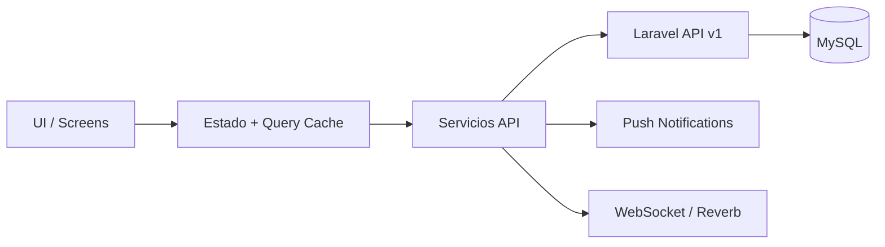

# 🐾 PawConnect — Propuesta Técnica para App Móvil

**Versión:** 1.0  
**Fecha:** Agosto 2026  
**Base:** Backend Laravel 11 con API REST v1

---

## 1. Objetivo

Definir una base técnica realista para una app móvil de PawConnect que reutilice la API existente, mantenga el mismo modelo de negocio y permita evolucionar sin rehacer el backend.

La app móvil debe cubrir, como mínimo:

- Autenticación y perfil de usuario
- Gestión de mascotas
- Match, chat y paseos
- Historial sanitario y recordatorios
- Marketplace y pedidos
- Lugares pet-friendly y favoritos

---

## 2. Recomendación

### Opción recomendada: React Native + Expo + TypeScript

La opción más equilibrada para PawConnect es **React Native con Expo**, por estas razones:

- El proyecto ya usa un stack con fuerte presencia de JavaScript en frontend.
- La API REST está preparada para consumo multiplataforma y ya tiene documentación con Scribe.
- Expo reduce complejidad inicial de configuración, builds y permisos nativos.
- TypeScript facilita contratos de datos consistentes entre backend y cliente móvil.
- La curva de entrada para el equipo es menor si ya existe experiencia web con JavaScript.

### Alternativa válida: Flutter

Flutter sigue siendo una buena opción si el objetivo principal fuera una UI muy controlada y un equipo centrado en Dart. Sin embargo, para este proyecto la prioridad es reutilizar el ecosistema actual, acelerar entrega y reducir coste operativo inicial.

---

## 3. Comparativa Breve

| Criterio | React Native + Expo | Flutter |
|---|---|---|
| Reutilización de conocimiento actual | Alta | Media |
| Velocidad de arranque | Alta | Media |
| Integración con API REST | Muy alta | Muy alta |
| Mantenimiento a medio plazo | Alta | Alta |
| Desarrollo de UI personalizada | Alta | Muy alta |
| Complejidad de configuración inicial | Baja | Media |
| Encaje con el stack actual del proyecto | Muy alto | Medio |

**Conclusión:** para PawConnect, React Native + Expo ofrece mejor relación entre velocidad, coste y alineación con el stack existente.

---

## 4. Arquitectura Propuesta

### 4.1 Capas



### 4.2 Principios

- Arquitectura modular por dominios.
- Componentes reutilizables y pantallas pequeñas.
- El backend sigue siendo la única fuente de verdad.
- La app móvil no duplica lógica de negocio; solo consume API.
- La autenticación se basa en Bearer token Sanctum.

---

## 5. Stack Técnico

### Base móvil

- **React Native**
- **Expo**
- **TypeScript**
- **React Navigation**

### Estado y datos

- **TanStack Query** para sincronización con API y caché de servidor
- **Zustand** para estado local liviano
- **Axios** o `fetch` con wrapper común para requests

### UI y experiencia

- **NativeWind** o **Tamagui** para estilos reutilizables
- **React Hook Form** + **Zod** para validación de formularios
- **Expo Image** o equivalente para imágenes

### Tiempo real y notificaciones

- **Laravel Reverb** para chat y eventos en tiempo real
- **Expo Notifications** para push locales/remotas

### Mapas y geolocalización

- **react-native-maps**
- Geolocalización nativa con permisos por plataforma

---

## 6. Estructura de Carpetas Sugerida

```text
app/
  src/
    api/
    components/
    config/
    constants/
    features/
      auth/
      pets/
      matches/
      chat/
      walks/
      health/
      marketplace/
      places/
      notifications/
      profile/
    hooks/
    navigation/
    screens/
    services/
    store/
    theme/
    types/
    utils/
```

### Convención de dominios

Cada módulo debe agrupar:

- pantallas
- componentes específicos
- hooks de consulta
- tipos TypeScript
- servicios API del dominio

---

## 7. Flujos Clave

### 7.1 Autenticación

1. Login o registro desde app móvil.
2. Laravel devuelve token Sanctum.
3. La app guarda el token en almacenamiento seguro.
4. Cada request usa `Authorization: Bearer {token}`.

### 7.2 Mascotas

- Listado de mascotas del usuario.
- Alta/edición con foto.
- Historial de salud asociado a cada mascota.

### 7.3 Match y chat

- Swipe con candidatos.
- Match confirmado por backend.
- Chat sincronizado por WebSocket.

### 7.4 Sanitario y marketplace

- Vista de historial sanitario.
- Botón para productos recomendados.
- Flujo de pedido y pago con redirección o integración nativa.

### 7.5 Lugares pet-friendly

- Mapa con filtros por categoría.
- Favoritos.
- Reseñas y detalle del lugar.

---

## 8. Seguridad

- Tokens Sanctum con expiración configurada.
- Almacenamiento seguro del token en el dispositivo.
- Validación de entrada en backend como fuente de verdad.
- CORS limitado a orígenes móviles autorizados.
- No exponer secretos en la app móvil.

### Recomendaciones de seguridad móvil

- Usar Secure Store / Keychain / Keystore para credenciales.
- Rotar tokens cuando el usuario vuelva a iniciar sesión.
- Invalidar sesiones desde backend al cerrar sesión.
- Evitar guardar datos sensibles en texto plano.

---

## 9. Integración con la API Laravel

### Endpoints prioritarios

- `POST /api/v1/auth/login`
- `POST /api/v1/auth/register`
- `GET /api/v1/users/me`
- `GET /api/v1/pets`
- `GET /api/v1/matches`
- `GET /api/v1/matches/{id}/messages`
- `GET /api/v1/notifications`
- `GET /api/v1/products`
- `GET /api/v1/orders`
- `GET /api/v1/places`

### Contrato esperado

La app debe consumir la misma estructura estándar que ya usa el backend:

```json
{
  "success": true,
  "message": "OK",
  "data": {}
}
```

---

## 10. Roadmap de Implementación

### Fase 1 - Base

- Crear proyecto Expo + TypeScript.
- Configurar navegación y temas.
- Implementar auth y persistencia de sesión.

### Fase 2 - Funcionalidades núcleo

- Pets, profile, notifications y places.
- Integración con API documentada.

### Fase 3 - Tiempo real y negocio

- Match, chat, walks y marketplace.
- Geolocalización y mapas.

### Fase 4 - Pulido

- Push notifications.
- Offline parcial.
- Analytics y telemetría.

---

## 11. Riesgos y Mitigaciones

| Riesgo | Mitigación |
|---|---|
| Desalineación con la API | Usar Scribe y contratos JSON estables |
| Gestión de tokens insegura | Secure Store / Keychain / Keystore |
| Complejidad del tiempo real | Reverb + capa de eventos aislada |
| Fragmentación por plataformas | Expo y TypeScript para reducir variabilidad |

---

## 12. Decisión Final

**Se recomienda React Native + Expo + TypeScript** para la app móvil de PawConnect porque:

- reduce el tiempo de salida al mercado,
- se alinea con el stack actual,
- facilita mantener un único backend Laravel,
- y deja abierta la posibilidad de evolucionar a Flutter si en el futuro se prioriza una UI nativa más personalizada.
