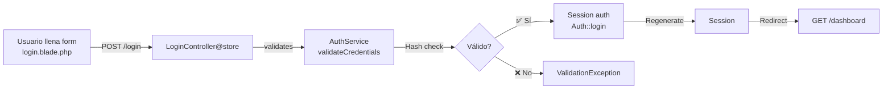
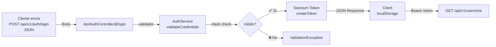

# 🔐 Arquitectura de Autenticación en PawConnect

**Versión:** 1.0 · **Última actualización:** Agosto 2026

---

## 1. Visión General

PawConnect tiene **dos tipos de clientes** que requieren autenticación diferente:

```
┌─────────────────────────────────────────────────────────┐
│                   PawConnect Backend                     │
│                    (Laravel 11)                          │
├─────────────────────────────────────────────────────────┤
│                                                          │
│  ┌──────────────────────────────────────────────────┐   │
│  │  AuthService (Lógica Compartida)                 │   │
│  │  ─────────────────────────────────────────────   │   │
│  │  • validateCredentials()                         │   │
│  │  • createUser()                                  │   │
│  │  • authenticateWeb()                             │   │
│  │  • revokeSameName()                              │   │
│  └──────────────────────────────────────────────────┘   │
│        ↑                                    ↑             │
│        │                                    │             │
│  ┌──────────────────┐           ┌──────────────────┐   │
│  │ WEB Controllers  │           │ API Controllers  │   │
│  │ ──────────────── │           │ ────────────────  │   │
│  │ • LoginControl   │           │ • AuthController │   │
│  │ • RegisterControl│           │   (Sanctum)      │   │
│  │ • ForgotPassword │           │                  │   │
│  └──────────────────┘           └──────────────────┘   │
│        ↓                                    ↓             │
│  Blade Views                        JSON Responses      │
│  (Form → Session)                   (Token → Sanctum)   │
│                                                          │
└─────────────────────────────────────────────────────────┘
```

---

## 2. Tipos de Clientes

### 2.1 **Clientes Web (Blade + Sesiones)**

**Cliente:** Navegador → vistas Blade → formularios HTML

**Flujo:**
```
1. Usuario llena formulario en login.blade.php
2. POST /login → LoginController@store
3. LoginController valida y autentica con Session web
4. Redirect a /dashboard con cookie de sesión
```

**Controllers:**
- `Web/LoginController` → maneja login con sesiones
- `Web/RegisterController` → maneja registro con sesiones
- `Web/ForgotPasswordController` → maneja recuperación de contraseña

**Autenticación:** 
- Middleware: `auth` (verifica sesión web)
- Guard: `web` (por defecto)

---

### 2.2 **Clientes API (JSON + Sanctum Tokens)**

**Cliente:** Móvil, SPA, aplicaciones de escritorio → JSON requests

**Flujo:**
```
1. POST /api/v1/auth/login con {"email", "password"}
2. → Api/AuthController@login
3. Valida credenciales
4. Revuelva token Sanctum (JWT)
5. Cliente guarda token en localStorage/keychain
6. Envía: Authorization: Bearer {token} en siguientes requests
```

**Controller:**
- `Api/AuthController` → maneja auth API con Sanctum

**Autenticación:**
- Middleware: `auth:sanctum` (verifica Bearer token)
- Guard: `sanctum` (devuelve user desde token)

---

## 3. AuthService: Lógica Compartida

Para evitar duplicar código, ambos tipos de autenticación usan `AuthService`:

```php
class AuthService
{
    // Usado por WEB y API
    public function validateCredentials(string $email, string $password): User
    public function createUser(array $validated): User
    
    // Solo para WEB
    public function authenticateWeb(User $user, bool $remember = false): void
    
    // Solo para API
    public function revokeSameName(User $user, string $name = 'auth_token'): void
}
```

**Ventajas:**
- ✅ Sin duplicación de validaciones
- ✅ Un único lugar para cambiar reglas de negocio
- ✅ Tests centralizados
- ✅ Fácil mantenimiento

---

## 4. Rutas Definidas

### 4.1 Rutas Web (Blade + Sesiones)

```php
// routes/web.php

// Vistas + formularios
GET  /login                    → render login.blade.php
POST /login                    → LoginController@store (name: login.store)

GET  /register                 → render register.blade.php
POST /register                 → RegisterController@store (name: register.store)

GET  /forgot-password          → render forgot-password.blade.php
POST /forgot-password          → ForgotPasswordController@store (name: password.email)

// Protegidas con auth middleware
GET  /dashboard                → DashboardController@index (name: web.dashboard)
...
```

### 4.2 Rutas API (JSON + Tokens)

```php
// routes/api.php - Base: /api/v1/

// Públicas (sin autenticación)
Route::prefix('auth')->name('auth.')->group(function () {
    POST /auth/register        → AuthController@register (name: api.v1.auth.register)
    POST /auth/login           → AuthController@login (name: api.v1.auth.login)
    POST /auth/forgot-password → AuthController@forgotPassword (name: api.v1.auth.forgot-password)
    POST /auth/reset-password  → AuthController@resetPassword (name: api.v1.auth.reset-password)
});

// Protegidas con auth:sanctum middleware
Route::middleware('auth:sanctum')->group(function () {
    POST /auth/logout          → AuthController@logout (name: api.v1.auth.logout)
    ...
});
```

---

## 5. Decisiones Arquitectónicas

### ¿Por qué dos tipos de controllers?

| Aspecto | Web | API |
|---|---|---|
| **Cliente** | Navegador (Blade) | Móvil, SPA, Desktop |
| **Respuesta** | HTML + Sesión web | JSON + Token Sanctum |
| **Autenticación** | Cookie de sesión | Bearer token en header |
| **Redirect** | ✅ Redirige a vista | ❌ No puede redirigir |
| **Estado** | Stateful (servidor) | Stateless (cliente guarda token) |

**Conclusión:** Es normal y recomendado tener controllers diferentes porque los clientes tienen necesidades distintas.

### ¿Todos tienen names()?

**SÍ.** Es una mejor práctica porque:

```php
// ✅ BIEN: Usar nombres
route('login.store')              // URL generada dinámicamente
url('dashboard')                  // Evita URLs hardcoded

// ❌ MAL: Sin nombres
action="/login"                   // Hardcoded, difícil mantener
redirect('/dashboard')            // Hardcoded
```

Si cambias `/login` a `/signin`, solo cambias en routing, no en vistas.

### ¿Por qué los formularios tenían action="#"?

Era un **placeholder temporal** durante desarrollo:

```html
<!-- Fase 1: Diseño (sin ruta decidida) -->
<form action="#" method="POST">

<!-- Fase 2: Desarrollo (ruta decidida) -->
<form action="{{ route('register.store') }}" method="POST">
```

Se completó login.blade.php pero dejaron los otros dos incompletos.

---

## 6. Flujos de Autenticación

### 6.1 Login Web



### 6.2 Login API



---

## 7. Testing

### 7.1 Test Web Login

```php
// tests/Feature/Auth/LoginTest.php
public function test_user_can_login_web(): void
{
    $user = User::factory()->create();
    
    $response = $this->post(route('login.store'), [
        'email'    => $user->email,
        'password' => 'password', // factory default
    ]);
    
    $this->assertAuthenticatedAs($user); // Verifica sesión
    $response->assertRedirect(route('web.dashboard'));
}
```

### 7.2 Test API Login

```php
// tests/Feature/Auth/ApiLoginTest.php
public function test_user_can_login_api(): void
{
    $user = User::factory()->create();
    
    $response = $this->postJson(route('api.v1.auth.login'), [
        'email'    => $user->email,
        'password' => 'password',
    ]);
    
    $response->assertOk();
    $response->assertJsonStructure(['data' => ['token']]);
}
```

---

## 8. Seguridad

### 8.1 Web (Sesiones)

- ✅ Cookie HttpOnly (No accesible desde JS)
- ✅ CSRF protection automático
- ✅ Session rotation cada login
- ✅ Token en <meta name="csrf-token">

### 8.2 API (Sanctum)

- ✅ Bearer token en Authorization header
- ✅ Token vence por inactividad
- ✅ Opción: Revocar tokens en logout
- ✅ Hash seguro de credenciales

---

## 9. Checklist de Implementación

- [x] AuthService con métodos compartidos
- [x] Web/LoginController → usa AuthService
- [x] Web/RegisterController → usa AuthService
- [x] Web/ForgotPasswordController → delega en Password facade
- [x] Api/AuthController → usa AuthService
- [x] Rutas API con names (api.v1.auth.*)
- [x] Rutas web con names (login.store, register.store, etc)
- [x] Vistas con action completo ({{ route('...') }})
- [x] Documentación de arquitectura (este archivo)

---

## 10. Referencias

- [Laravel Sanctum](https://laravel.com/docs/11.x/sanctum)
- [Laravel Authentication](https://laravel.com/docs/11.x/authentication)
- [Password Reset](https://laravel.com/docs/11.x/passwords)
- [Named Routes](https://laravel.com/docs/11.x/routing#named-routes)
